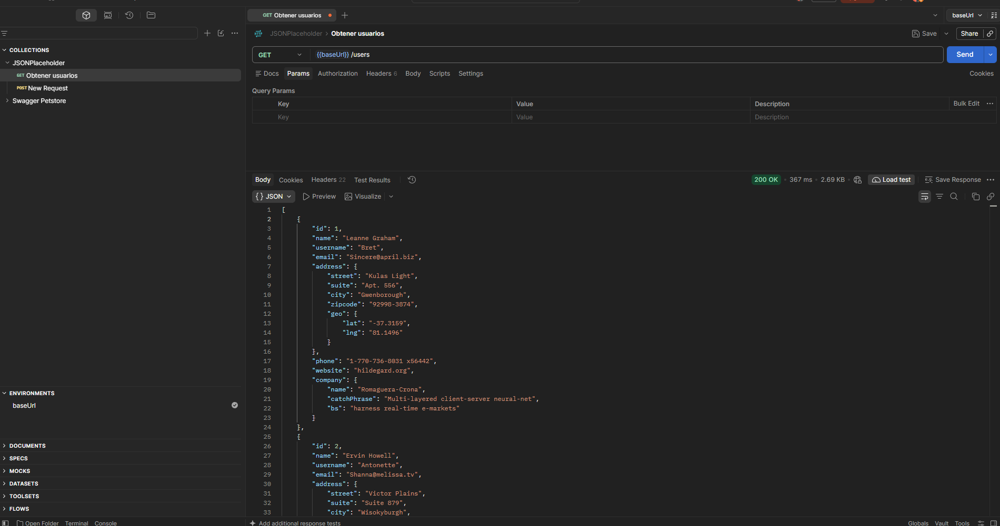
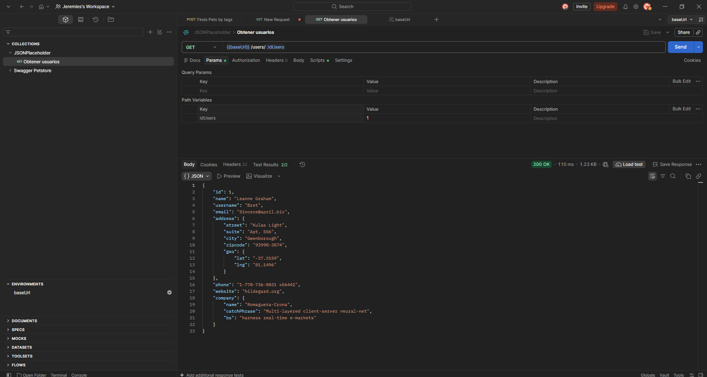
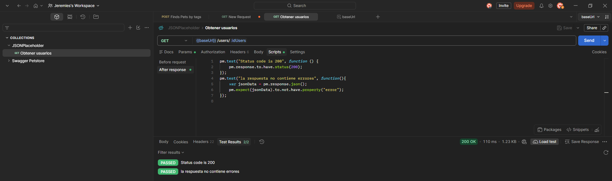
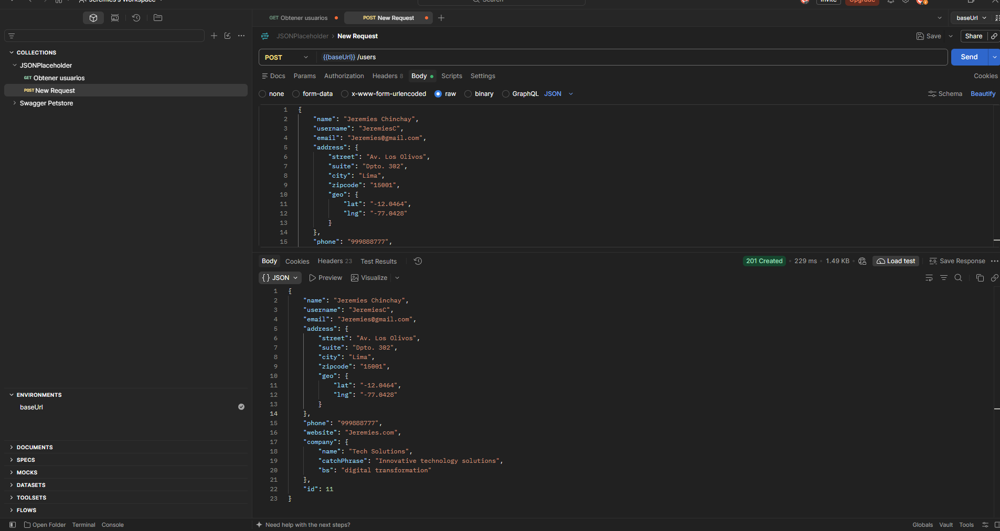
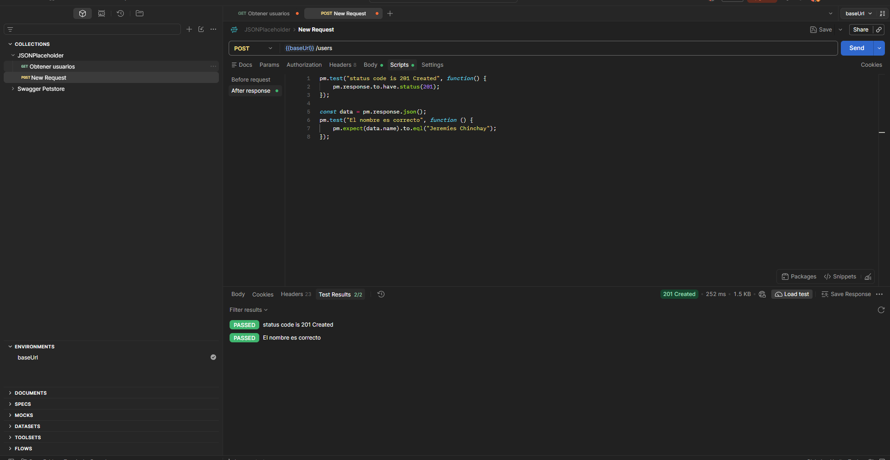
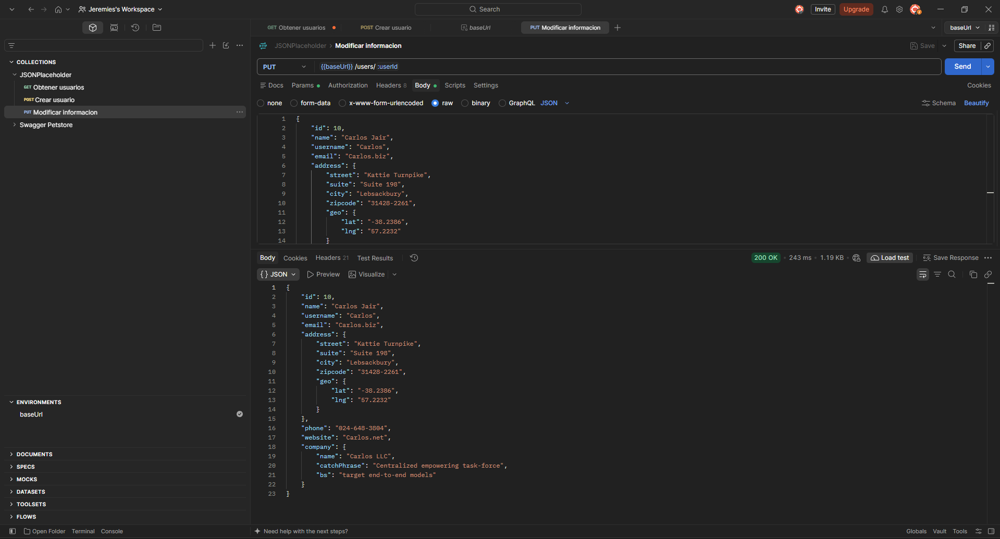
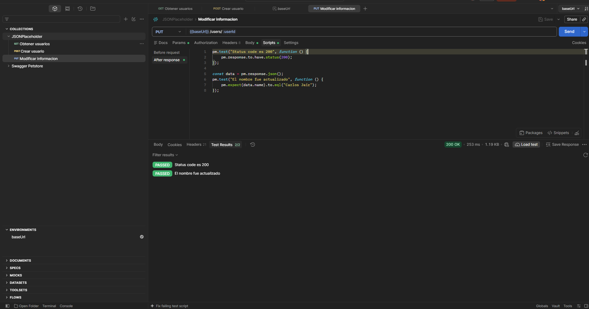

# PlaceHolder-Postman-practica

Para la practica estoy utilizando la API JSONPlaceholder.

Primero creo la variable baseUrl

## Metodo GET

Primero obtengo a todo los clientes

Luego creo la Variable Path para buscar usuarios individualmente.

Y por ultimo mediante scripts valido correctamente el status

## Método POST

Creación de un nuevo usuario

Y mediante scripts validamos que la creación de usuarios se ejecuto exitosamente.

## Método PUT

Se realizo la Modificación de información de usuario

Y mediante scripts validamos que se ejecuto exitosamente.

